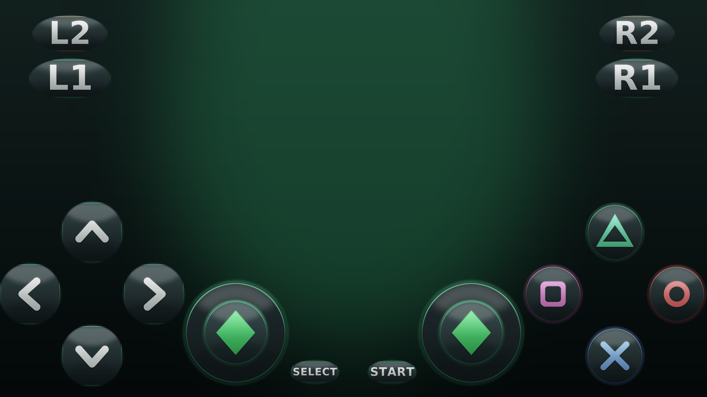

# Sims 2 Mobile — The Sims 2 (PS2) no Android, com teclado virtual bonito



## Duas versões — escolha uma

| Versão | Tamanho | O jogo vem dentro? |
|---|---|---|
| `Sims2Mobile-ARMSX2.apk` | **73 MB** | Não. Você aponta a pasta onde está seu jogo |
| `Sims2Mobile-BUNDLE.apk` | **939 MB** | **Sim.** O jogo vai comprimido (CSO) dentro do APK e o app extrai na 1ª execução |

Em **nenhuma** das duas a BIOS vem embutida: você escolhe e coloca o seu dump
(`scphXXXXX.bin`) na tela *"Selecione sua BIOS"* do emulador.

### Por que o BUNDLE usa CSO (e não o ISO cru)

| Arquivo | Tamanho |
|---|---|
| ISO original (do seu zip) | 3.550.085.120 B = **3,31 GB** |
| CSO gerado (`tools/iso_to_cso.py`) | 985.068.753 B = **939 MB** |

Comprime **3,60x sem perder nada**: o `tools/iso_to_cso.py` decodifica o CSO de
volta e compara o SHA-256 com o ISO original (passo `--verify`, obrigatório).
O formato segue o `pcsx2/CDVD/CsoFileReader.cpp` do emulador (CISOV1, deflate
raw por bloco, índice `u32` com bit31 = bloco cru).

Resultado no celular: **939 MB** em `Download/Sims2/sims2.cso` em vez de 3,31 GB.
Depois de extrair, o bundle pode ser desinstalado (o jogo fica no arquivo).

Pacote completo para jogar **The Sims 2 (PlayStation 2)** no celular, com um
teclado virtual (controle na tela) redesenhado do zero e um perfil de desempenho
pensado para GPUs fracas como a **Mali-G52**.

---

## 0. Baixar os arquivos (GitHub)

**Release (recomendado):**
<https://github.com/davimikeben/Sims-2-The/releases/tag/v1.0-sims2-mobile>

Links diretos:

| Arquivo | Link |
|---|---|
| **APK BUNDLE (939 MB, com o jogo)** | [Sims2Mobile-BUNDLE.apk](https://github.com/davimikeben/Sims-2-The/releases/download/v1.1-bundle/Sims2Mobile-BUNDLE.apk) |
| APK leve (73 MB, sem o jogo) | [Sims2Mobile-ARMSX2.apk](https://github.com/davimikeben/Sims-2-The/releases/download/v1.0-sims2-mobile/Sims2Mobile-ARMSX2.apk) |
| Skin (2,1 MB) | [sims2-controller-skin.zip](https://github.com/davimikeben/Sims-2-The/releases/download/v1.0-sims2-mobile/sims2-controller-skin.zip) |
| Mockup | [preview.png](https://github.com/davimikeben/Sims-2-The/releases/download/v1.0-sims2-mobile/preview.png) |
| Guia Mali-G52 | [PERFIL-MALI-G52.md](https://github.com/davimikeben/Sims-2-The/releases/download/v1.0-sims2-mobile/PERFIL-MALI-G52.md) |
| Checksums | [SHA256.txt](https://github.com/davimikeben/Sims-2-The/releases/download/v1.0-sims2-mobile/SHA256.txt) |

O APK também está versionado no repositório, em
[`dist/Sims2Mobile-ARMSX2.apk`](https://github.com/davimikeben/Sims-2-The/blob/cline/qj7c5kzj/dist/Sims2Mobile-ARMSX2.apk)
(caso a página de Releases não abra para você).

---

## 1. Antes de tudo: a verdade tecnica sobre "transformar ROM em APK"

O arquivo que voce mandou e:

```
Sims 2 The (Europe) (EnFrDeEsItNlSvNoDaFi).zip     932 MB
└── Sims 2, The (Europe) (En,Fr,De,Es,It,Nl,Sv,No,Da,Fi).iso   3.385 MB
     └── ISO de DVD = PlayStation 2 (PAL, multi-idioma)
```

Um jogo de PS2 **nao pode** ser convertido em APK: o APK e um app Android (ARM64)
e o jogo e codigo MIPS R5900 + Emotion Engine + Graphics Synthesizer. Quem
traduz uma coisa na outra e um **emulador**. Entao o que existe de verdade — e e
o que este repositorio entrega — e:

```
APK (emulador ARMSX2 + skin do teclado virtual embutida) + ISO do jogo + BIOS do PS2
```

Tambem nao coloquei o ISO dentro do APK de proposito: 3,3 GB em `assets/`
obrigaria o Android a extrair tudo na instalacao (precisaria de ~7 GB livres) e o
app leria o jogo bem mais devagar. O ISO fica no armazenamento do aparelho, que e
mais rapido e permite trocar de jogo sem reinstalar nada.

---

## 2. O que esta pronto neste repositorio

| Arquivo | O que e |
|---|---|
| `dist/Sims2Mobile-ARMSX2.apk` | **O APK**: ARMSX2 2.9.1 (emulador PS2 ARM64, GPL-3) reempacotado, com a skin **Plumbob Glass** embutida e assinado. Android 8.0+ (arm64). |
| `dist/sims2-controller-skin.zip` | So a skin, para importar em qualquer ARMSX2 compativel. |
| `skin/src/*.png` | As 22 imagens do teclado virtual (fonte da arte). |
| `tools/gen_skin.py` | Gerador da arte (Pillow): muda cor/tema e re-renderiza tudo. |
| `tools/build_release.sh` | Empacota o ZIP e re-assina o APK com a skin embutida. |
| `docs/PERFIL-MALI-G52.md` | Ajustes exatos para rodar bem em Mali-G52 / celular fraco. |
| `docs/preview.png` | Mockup do teclado virtual. |

---

## 3. Instalacao no celular (5 passos)

1. **Copie para o celular**: `dist/Sims2Mobile-ARMSX2.apk` e o seu
   `Sims 2, The (...).iso` (extraia do zip antes — o emulador le o `.iso`, nao o
   `.zip`).
2. **Instale o APK**. Se ja tem o ARMSX2/AetherSX2 instalado, **desinstale
   antes**: este APK tem assinatura propria (de homebrew), entao o Android vai
   recusar a atualizacao por cima.
3. **BIOS**: o emulador precisa de um dump da BIOS do PS2 (`scphXXXXX.bin`), de
   um console que voce possua. Coloque na pasta que ele pedir no assistente
   inicial.
4. Na tela **Skins de Controle Personalizadas**, a skin ja vem embutida: escolha
   **"NetherSX2"** (e o slot onde a Plumbob Glass foi gravada). Se preferir a
   versao avulsa: **Importar .zip de skin…** -> `sims2-controller-skin.zip`.
5. **Adicione o jogo**: aponte a pasta de ROMs para onde esta o `.iso`, toque na
   capa e jogue. Rode o assistente **Desempenho** e siga
   `docs/PERFIL-MALI-G52.md`.

> ⚠️ Desempenho honesto: PS2 em celular com Mali-G52 (Helio G85/G70, Exynos 850…)
> e o limite do limite. The Sims 2 e um jogo 3D de mundo aberto: espere algo
> entre **15 e 30 fps**, com resolucao interna reduzida. Com Snapdragon/Adreno
> sobe bastante. Para rodar liso de verdade, a versao de **GBA/DS** do The Sims 2
> e outra liga (mas nao e a que esta no seu zip).

---

## 4. O teclado virtual "Plumbob Glass"

A arte foi desenhada para o desenho real do ARMSX2 (`ContentScale.Fit` dentro de
uma caixa quadrada, com `alpha` controlado pelo slider de opacidade) — por isso
todo botão é quadrado com fundo **transparente**, nunca preto.

- 22 imagens: `cross`, `circle`, `square`, `triangle`, `up/down/left/right`,
  `l1 l2 r1 r2`, `l3 r3`, `start`, `select`, `macro1..4`, `analog_base`,
  `analog_stick`.
- Estilo: vidro escuro (gradiente + especular + bisel), aro de menta com brilho,
  símbolos embossados nas cores do DualShock e losango *plumbob* nos analógicos.
- Três camadas de antialias: formas desenhadas a 4× e reduzidas com Lanczos,
  halo radial com *clamp* nas bordas (senão o brilho virava uma "placa
  quadrada" ao escalar) e queda suave (smoothstep) nos cortes de luz.

Para mudar o tema:

```bash
# edite as cores no topo de tools/gen_skin.py  (MINT, GOLD, PLUMBOB, etc.)
python3 tools/gen_skin.py --out skin/src --preview docs/preview.png
```

Depois é só reimportar o ZIP (ou rodar `tools/build_release.sh` para gerar o APK).

### Ajustes do teclado dentro do jogo

Em **Configurações › Controles na tela**: opacidade, tamanho, posição de cada
botão (arraste), multi-touch, turbo, macros (M1–M4) e layout por jogo. A skin não
tem variante "pressionada": o app já aplica escurecimento + encolhimento ao
tocar, então o feedback continua igual.

---

## 5. Como o APK foi construído (reprodutível)

```bash
# 1. baixar o ARMSX2 oficial (GPL-3) — build legacy armv8.0 / minSdk 26
curl -LO https://github.com/ARMSX2/ARMSX2/releases/download/2.9.1/ARMSX2-2.9.1-legacy-armv8.0-sdk26.apk
mv ARMSX2-2.9.1-legacy-armv8.0-sdk26.apk build/armsx2-legacy.apk

# 2. gerar a arte + empacotar + assinar
python3 tools/gen_skin.py --out skin/src --preview docs/preview.png
bash tools/build_release.sh
```

`build_release.sh` substitui `assets/controller_skins/nethersx2*` pela nossa
arte (os dois slots embutidos do app), roda `zipalign -p 4` e assina com
`apksigner` (v2+v3) usando `build/sims2.keystore`, criado na primeira execução.

O código do emulador é GPL-3.0 e está em <https://github.com/ARMSX2/ARMSX2>.
Este repositório **não** redistribui o jogo nem a BIOS — você usa os seus.

---

## 6. Problemas comuns

| Sintoma | Causa / solução |
|---|---|
| "App não instalado" | Existe outro ARMSX2/AetherSX2 com assinatura diferente. Desinstale o antigo. |
| "Não foi possível analisar o pacote" | Cópia corrompida — copie de novo (73 MB) e confira o sha256. |
| Tela preta com áudio | Troque Renderizador Vulkan ↔ OpenGL (veja `docs/PERFIL-MALI-G52.md`). |
| Skin importada mas não aparece | O ZIP precisa ter os PNGs na **raiz** (`ic_controller_*.png`), sem subpasta. |
| Jogo não abre | Falta BIOS, ou o `.iso` ainda está dentro do `.zip`. |
| Muito lento | Perfil de Speedhack **Low-End**, Resolução de Exibição **1x PS2**, Frame Skip 1–2. |

---

## 7. Verificação dos arquivos

```
dist/SHA256.txt
```

| Arquivo | SHA-256 |
|---|---|
| `Sims2Mobile-ARMSX2.apk` | `c604cfb517dcad2fee0dd0585d3b7489d96e09d72cec9a9243ba09726c8c5464` |
| `sims2-controller-skin.zip` | `b270ee804f5fa18c5fb62125fa8430975eeeaa9c8d4c15a9b61129da923b86d0` |
| `Sims2Mobile-BUNDLE.apk` | `b3854b8a921f427bf755476fb41341f200e4d913659d3063c93beb54803e0ce1` |

O APK está assinado com certificado próprio de homebrew:

```
CN=Sims 2 Mobile, OU=Homebrew, O=Sims2Mobile, L=BR, C=BR
SHA-256: 0ab67d1838f0e157f0ddf806f7023d4832fdb0818c567424fff9e141f9935ea6
Schemes: APK Signature Scheme v2 + v3
```
